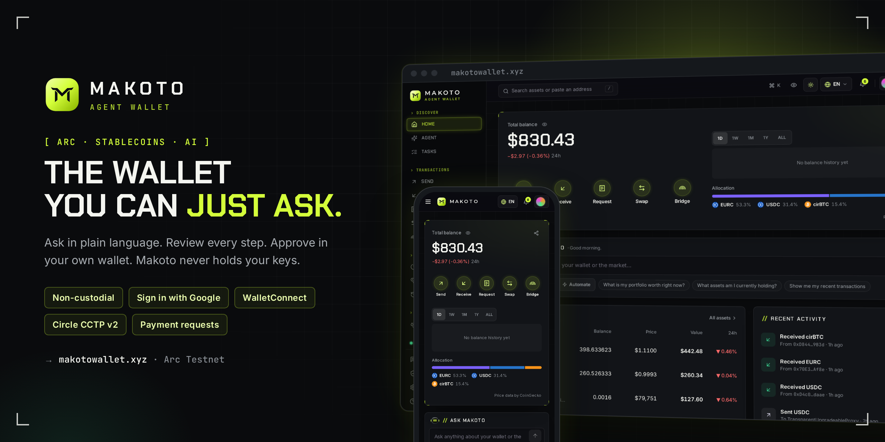
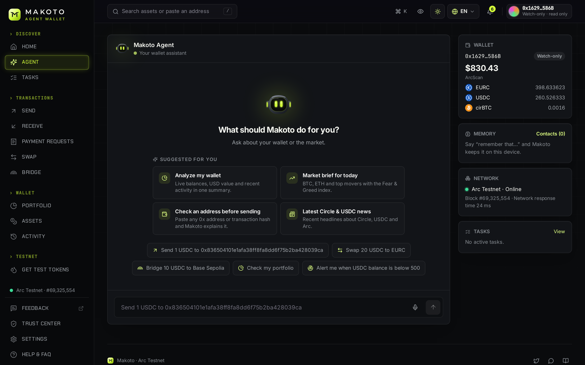
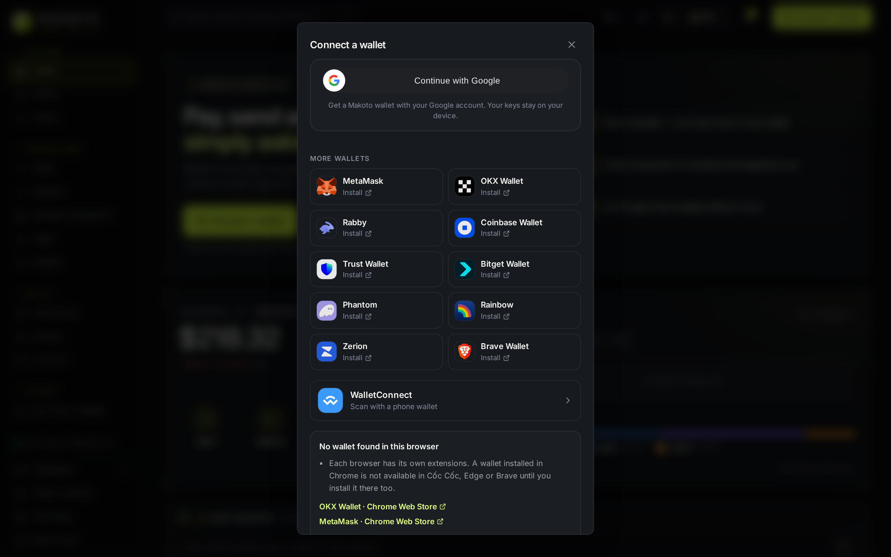
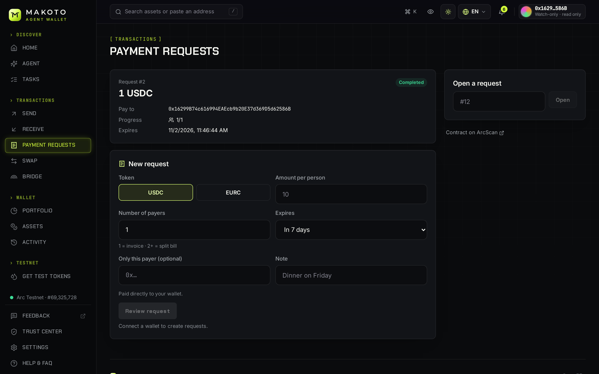
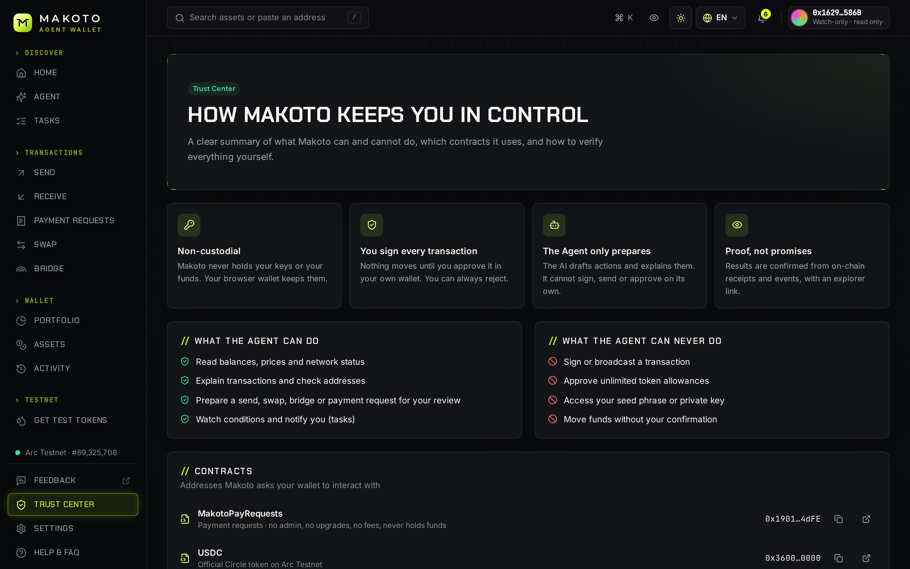
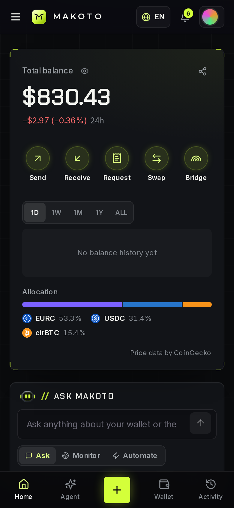
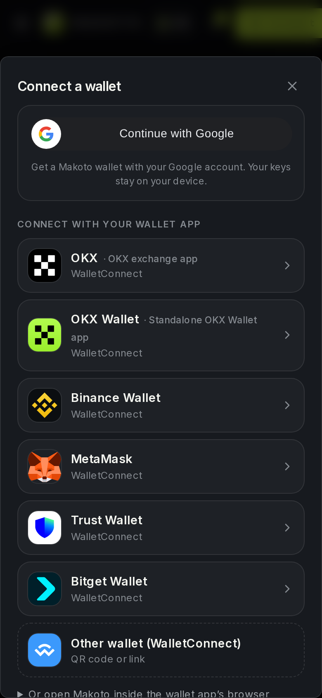
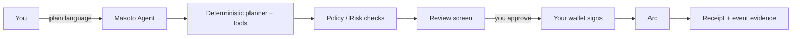

<p align="center">
  <a href="https://makotowallet.xyz">
    
  </a>
</p>

<h1 align="center">Makoto Wallet</h1>

<p align="center">
  <b>The AI agent wallet for stablecoins on Arc.</b><br/>
  Ask in plain language · review every step · approve in your own wallet.
</p>

<p align="center">
  <a href="https://makotowallet.xyz"></a>
  <a href="https://github.com/congthuat/Makoto-Wallet/actions/workflows/ci.yml"></a>
  
  
  
</p>

<p align="center">
  <a href="https://makotowallet.xyz"><b>Open the app</b></a> ·
  <a href="https://makotowallet.xyz/#trust">Trust Center</a> ·
  <a href="docs/README.md">Documentation</a> ·
  <a href="https://github.com/congthuat/Makoto-Wallet/issues">Report an issue</a>
</p>

---

## Why Makoto

Stablecoin wallets are powerful but unforgiving: long addresses, unfamiliar networks, approvals nobody reads. **Makoto turns intent into a clear, reviewable transaction**, so you can just say *"send 20 USDC to Linh"*, *"bridge 50 USDC to Base"* or *"alert me if BTC drops below 75k"*.

The AI **prepares**. **You approve.** Makoto never holds your keys, and the Agent can never sign.

## Highlights

| | |
| --- | --- |
| 🤖 **AI Agent** | Streams answers from live wallet, price, Arc network, Circle fee, market and news data. Draws price charts, remembers your contacts on-device, and builds multi-step plans where every step is reviewed and signed separately. |
| 🔑 **Sign in with Google** | One tap creates your own Makoto wallet with a standard **12 or 24-word** recovery phrase that also works in OKX and MetaMask. The phrase is generated and encrypted **on your device**; the server only stores ciphertext it cannot read. |
| 📱 **Connect any wallet** | Browser extensions via EIP-6963 (MetaMask, OKX, Rabby, Coinbase, Trust, Bitget, Phantom, Rainbow, Zerion, Brave). On phones, **WalletConnect** opens OKX, Binance, MetaMask, Trust or Bitget and returns you connected. QR pairing on desktop. |
| 💸 **Send · Swap · Bridge** | USDC, EURC and cirBTC transfers with address-poisoning checks; USDC ↔ EURC swaps with exact approvals; USDC bridging to Base Sepolia through **Circle CCTP v2**. |
| 🧾 **Payment requests** | Invoices and bill splitting in USDC/EURC with shareable links and QR codes, powered by `MakotoPayRequests`: no owner, no admin, no fees, never holds funds. |
| ⏰ **Tasks & alerts** | Balance thresholds, BTC/ETH/SOL price alerts and daily summaries run on a persistent scheduler. Notify-only: no unattended signing, ever. |
| 🛡️ **Trust Center** | A plain-language page listing what Makoto can and cannot do, which contracts it touches, and how to verify everything yourself. |

## Screenshots

<p align="center">
  
  
</p>
<p align="center">
  
  
</p>
<p align="center">
  
  
</p>

## How Makoto keeps you in control



**The AI can never:** sign or broadcast a transaction · see a private key or recovery phrase · approve unlimited allowances · bypass Policy/Risk or your review · fabricate balances or quotes · mark a transaction confirmed.

**Transactions are evidence-based.** `PREPARE ≠ EXECUTE`: preparing a request is separate from handing it to your wallet. `USER_REJECTED`, `PENDING`, `UNKNOWN` and `CONFIRMED` stay distinct, and success is only shown after a receipt *and* the matching on-chain event.

### Google wallet security model

| What | Where it lives |
| --- | --- |
| Recovery phrase (BIP39, 12/24 words) | Generated in your browser; never sent anywhere in plain text |
| Wallet password | Only in your head; never sent to Makoto |
| Encrypted backup | PBKDF2-SHA256 (600k) → AES-256-GCM, bound to your Google account; stored as ciphertext only |
| Google sign-in | Identity only, verified server-side (audience, issuer, expiry, verified email) |
| Signing | Unlocked key stays in tab memory; **every** signature opens Makoto's Approve / Reject screen |

Forgetting the password **and** losing the recovery phrase means the wallet cannot be recovered. That is by design: nobody, including Makoto, can recover it for you.

## Contracts (Arc Testnet)

| Contract | Address |
| --- | --- |
| MakotoPayRequests | [`0x190132A7C8D218845c2769471C625E6da5eE4dFE`](https://testnet.arcscan.app/address/0x190132A7C8D218845c2769471C625E6da5eE4dFE?tab=contract) ✅ source verified |
| USDC (Circle) | [`0x3600000000000000000000000000000000000000`](https://testnet.arcscan.app/address/0x3600000000000000000000000000000000000000) |
| EURC (Circle) | [`0x89B50855Aa3bE2F677cD6303Cec089B5F319D72a`](https://testnet.arcscan.app/address/0x89B50855Aa3bE2F677cD6303Cec089B5F319D72a) |
| cirBTC | [`0xf0C4a4CE82A5746AbAAd9425360Ab04fbBA432BF`](https://testnet.arcscan.app/address/0xf0C4a4CE82A5746AbAAd9425360Ab04fbBA432BF) |

Source: [`contracts/src/MakotoPayRequests.sol`](contracts/src) (Foundry, Solidity 0.8.24).

## Tech stack

| Layer | Technology |
| --- | --- |
| Frontend | React 19 · TypeScript · Vite · Tailwind CSS 4 · viem |
| Wallets | EIP-1193 / EIP-6963 · WalletConnect v2 · embedded BIP39 wallet |
| Backend | Node.js · Express · SQLite (WAL) |
| AI | OpenAI Responses API (tool calling, streaming) behind a deterministic planner |
| Chain & bridge | Arc Testnet · Circle CCTP v2 |
| Data | CoinGecko · ArcScan · Surf market data |
| Hosting | Vercel (frontend) · Railway / Oracle Cloud (backend) · same-origin `/api` proxy |

## Repository structure

```text
frontend/    Wallet UI, Agent, wallet connections, embedded wallet
backend/     API, Google/SIWE auth, encrypted vault store, scheduler, Agent tools
contracts/   MakotoPayRequests (Foundry)
deploy/      Oracle Cloud deployment kit (setup, backups, updates)
docs/        Architecture notes, integration scopes, QA evidence
shared/      Shared portfolio valuation
```

## Run locally

Requires **Node.js ≥ 24**.

```sh
npm install --prefix backend
npm install --prefix frontend
cp backend/.env.example backend/.env     # add your own server-side keys
cp frontend/.env.example frontend/.env
npm run dev
```

- App: http://localhost:5173
- API health: http://localhost:3001/api/health

Keys stay server-side. `SURF_API_KEY` is required; CoinGecko enables pricing; the LLM provider is optional. Google sign-in uses the public OAuth client id (`GOOGLE_CLIENT_ID`).

Production build:

```sh
npm run build --prefix frontend   # needs BACKEND_PORT and BASE_PATH (may be empty)
```

Quality gates run on every push: type-check, lint, unit tests, browser regressions (mock wallet) and backend tests. See [`ci.yml`](.github/workflows/ci.yml).

## Documentation

[Project state](docs/PROJECT_STATE.md) · [LLM Agent](docs/LLM_AGENT_INTEGRATION.md) · [Home & wallet UX](docs/AGENT_HOME_UX.md) · [Circle CCTP v2](docs/CIRCLE_CCTP_V2_INTEGRATION.md) · [Portfolio history](docs/PORTFOLIO_HISTORY.md) · [Task claims](docs/TASK_EXECUTION_CLAIMS.md) · [Pricing](docs/PRICING_PROVIDER.md) · [All docs](docs/README.md)

## Status & limitations

- **Testnet only.** Arc Testnet assets have no real-world value. Base Sepolia is the supported CCTP destination.
- **No independent security audit yet.** Makoto is not mainnet-ready financial software.
- CCTP writes are USDC-only (Arc Testnet → Base Sepolia); live destination completion is not yet claimed by recorded evidence.
- Portfolio history starts at the first verified observation, with no backfill.
- The scheduler's SQLite coordination is single-host, not a distributed lock.

## Security

Found a vulnerability? Please follow [SECURITY.md](SECURITY.md) for private reporting. Makoto will **never** ask for your recovery phrase.

<p align="center"><sub>Built on <a href="https://arc.network">Arc</a> · Powered by Circle stablecoins</sub></p>
